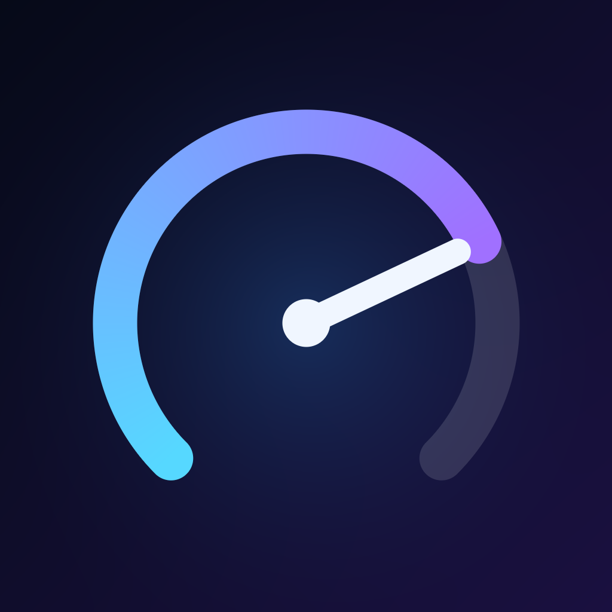

<p align="center">
  
</p>

<h1 align="center">📶 EasyCellular</h1>

<p align="center">
  Диагностика сотовой сети для iPhone и Android: тип сети, сигнал, оператор, пинг и скорость.<br/>
  Интерфейс на русском и английском.
</p>

<p align="center">
  
  
  
  
  
  <a href="https://github.com/<ваш-логин>/EasyCellular/actions/workflows/build.yml">
    /EasyCellular/actions/workflows/build.yml/badge.svg" alt="Build" />
  </a>
</p>

---

## ✨ Возможности

| Функция | Android | iOS |
|---|:---:|:---:|
| Тип сети 2G / 3G / 4G / 5G | ✅ | ✅ |
| Признак 5G+ | ✅ точный, по данным оператора (NR Advanced) | ⚠️ оценка по скорости (от 500 Мбит/с) |
| Сигнал RSRP / RSRQ / SINR по вышке | ✅ | ❌ iOS не отдаёт |
| Диапазон, PCI, канал, Cell ID | ✅ | ❌ iOS не отдаёт |
| Оператор, страна, MCC-MNC | ✅ | ⚠️ оператор часто скрыт с iOS 16 |
| Все SIM и eSIM | ✅ подробно | ✅ базово |
| Пинг с джиттером и потерями | ✅ | ✅ |
| Тест скорости, загрузка и отдача | ✅ | ✅ |
| История и график | ✅ | ✅ |
| Определитель платформы | ✅ экран «Устройство» | ✅ строка в «О приложении» |
| Язык RU / EN | ✅ | ✅ |

> Разница между платформами связана с ограничениями систем. Android открывает приложениям данные вышек при наличии разрешений. iOS закрывает их почти полностью, поэтому на iPhone показываются только данные, которые система разрешает.

---

## 📦 Скачать

Готовые файлы публикуются в разделе **[Releases](https://github.com/<ваш-логин>/EasyCellular/releases)**. Каждая сборка создаёт новый релиз с номером, и в нём два файла:

- **`EasyCellular.ipa`** — для iPhone (iOS 16 и новее)
- **`EasyCellular.apk`** — для Android (Android 12 и новее)

---

## 🚀 Установка

### iPhone

Приложение не публикуется в App Store, поэтому его ставят через подпись бесплатным Apple ID:

1. Установите на компьютер или телефон одно из приложений: [Sideloadly](https://sideloadly.io), [AltStore](https://altstore.io) или [Feather](https://github.com/khcrysalis/Feather).
2. Войдите своим Apple ID и перетащите `EasyCellular.ipa` в установщик.
3. На iPhone откройте **Настройки → Основные → VPN и управление устройством** и подтвердите доверие к разработчику.

> ⏳ С бесплатным Apple ID подпись действует около 7 дней, после чего приложение нужно установить заново.

### Android

1. Скачайте `EasyCellular.apk` на телефон.
2. Разрешите установку из этого источника в настройках.
3. Откройте файл и установите приложение.
4. При первом запуске выдайте разрешения, если хотите видеть точные данные вышки.

---

## 🔐 Разрешения Android

| Разрешение | Зачем |
|---|---|
| `READ_PHONE_STATE` | Тип сети, 5G+, SIM, сигнал, роуминг |
| `ACCESS_FINE_LOCATION` | Данные вышек. Android требует геолокацию для Cell ID и диапазона |
| `INTERNET`, `ACCESS_NETWORK_STATE` | Пинг и тест скорости |

Без разрешений приложение работает, но показывает меньше данных.

---

## 🗂 Структура репозитория

```
EasyCellular/
├── .github/workflows/
│   └── build.yml            # сборка .ipa и .apk, публикация в Releases
├── ios/                     # проект iOS: XcodeGen, Swift, SwiftUI
│   ├── project.yml
│   └── EasyCellular/
└── android/                 # проект Android: Kotlin, Jetpack Compose
    ├── app/
    └── settings.gradle.kts
```

Подробные инструкции по каждой платформе:

- [`ios/README.md`](ios/README.md): сборка iOS, иконка, язык
- [`android/README.md`](android/README.md): сборка Android, версии SDK, язык

---

## 🛠 Сборка

Сборка запускается автоматически при каждом push в `main` или `master`. Можно также запустить вручную: **Actions → Build IPA and APK → Run workflow**.

Что происходит внутри:

1. Собирается iOS-проект без подписи и упаковывается в `EasyCellular.ipa`.
2. Собирается Android-проект в debug-версии и получается `EasyCellular.apk`.
3. Оба файла публикуются в новом релизе.

Локальная сборка:

```bash
# iOS (нужен macOS и Xcode)
cd ios && brew install xcodegen && xcodegen generate && open EasyCellular.xcodeproj

# Android (нужен Android Studio с SDK Platform 37)
cd android && ./gradlew :app:assembleDebug
```

---

## 🌍 Добавить язык

Тексты интерфейса лежат в двух местах:

- **iOS:** `ios/EasyCellular/Strings.swift`. Язык добавляется в `enum AppLanguage` в `ios/EasyCellular/App/AppSettings.swift`.
- **Android:** `android/app/src/main/java/com/werty/easycellular/i18n/Strings.kt`. Язык добавляется в `enum class Lang`.

Для каждого ключа добавьте перевод под новым кодом. Если перевода нет, показывается английский вариант, а при отсутствии ключа приложение не падает и показывает сам ключ.

---

## ⚠️ Ограничения

- **Тест скорости расходует трафик.** На канале 1 Гбит/с один запуск может стоить около гигабайта. Лучше запускать его на Wi-Fi или безлимитном тарифе.
- **Пинг измеряется через TCP** (`1.1.1.1:443`), потому что ICMP без root недоступен на обеих платформах.
- **Оператор на iOS.** Начиная с iOS 16 Apple часто скрывает название оператора от сторонних приложений. В таком случае показывается «Недоступно».
- **5G+ на iOS** определяется по скорости, а не по признаку оператора, потому что iOS такой признак не отдаёт.

---

## 🔒 Приватность

- Приложение не отправляет ваши данные на собственные серверы.
- История хранится только на устройстве.
- Замеры идут на публичные серверы [Cloudflare](https://speed.cloudflare.com), а внешний IP определяется через [ipify](https://www.ipify.org).

---

## 🤝 Вклад в проект

Идеи, баг-репорты и pull request приветствуются. Если сборка упала, приложите строку с `error:` из лога шага сборки, и проблему будет проще найти.

---

## 📄 Лицензия

Пока не выбрана. Добавьте файл `LICENSE`, когда решите, как распространять проект.
